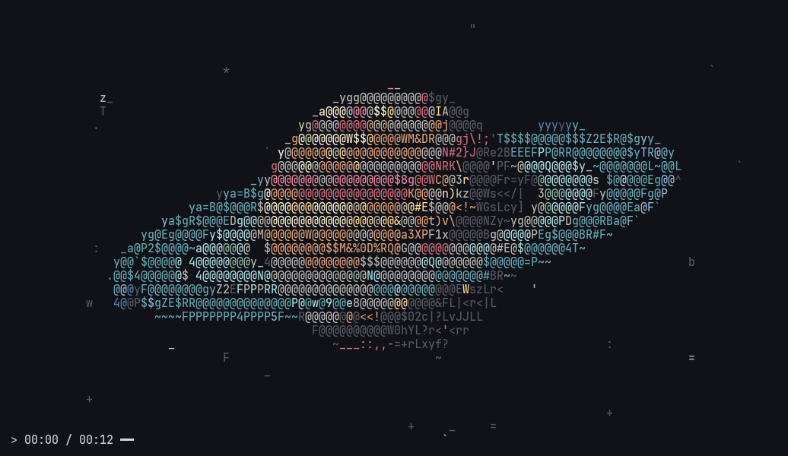

# asciier

Terminal viewer and converter: video, audio and images as ASCII art in the kitty theme's colours.



[Download the 10-second terminal recording (MP4).](https://github.com/6pebbles/asciier/releases/download/v0.1.1/asciier-demo.mp4)

```
asciier FILE                      view
asciier convert [options] INPUT   write PNG or MP4
```

Keys: F1. Options: `asciier convert --help`.

On Arch Linux, run `makepkg -si` from [packaging/aur](packaging/aur).

Build: `cargo install --path . --root ~/.local --locked`. Test: `cargo test`.

Needs: libmpv, libchafa, FreeType, libdbus, libdav1d; the font JetBrainsMono Nerd Font Mono, found by `fc-match`; a kitty theme at `~/.config/kitty/current-theme.conf`; `ffmpeg` and `ffprobe` to convert video.

Uses when present: kitty graphics for the image itself (`v`), `kitten` (ligatures off while viewing, the `--at` preview), `wl-copy` (`y`), `hyprctl` (`f`), a `scope` program that draws audio-only files.

License: GPL-3.0-or-later.
